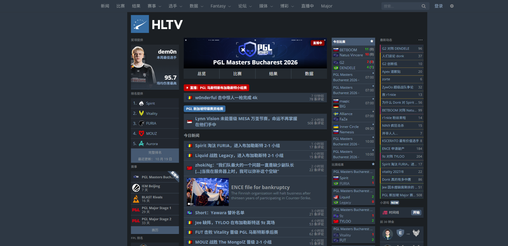
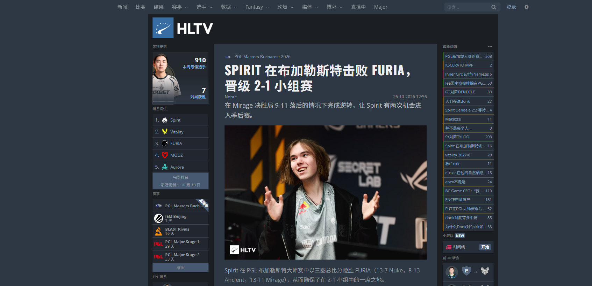
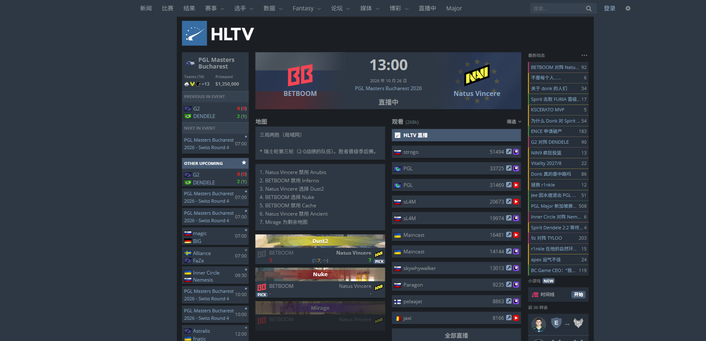

# 🔥 HLTV 终于有中文版了！一个油猴脚本，把 HLTV.org 整站翻成简体中文，还顺手干掉了博彩广告

**看 CS2 新闻再也不用开翻译插件逐段复制 —— 装上就是中文、干净的 HLTV：菜单、新闻、论坛、比赛页全汉化，「立即捡钱」博彩广告和满屏赔率全部消失**

> HLTV 是全世界最大的 CS2 / CS:GO 资讯站，比赛、排名、转会、选手数据都在这里 —— 可它**只有英文**。
> 这个脚本让你打开 hltv.org 就看到中文：导航菜单、侧边栏、比赛结果、战队排名、选手数据、转会动态全部汉化，**新闻和论坛帖子自动机翻**，而且 **Major、IGL、VRS、Rating 这些圈内术语一个都不乱翻**。

## 😤 为什么你需要它

用浏览器自带的整页翻译刷 HLTV，你大概见过这些：

- `Major` 被翻成「特锦赛」「主要的」，`AWP` 变成「狙击步枪」，`Rating 2.0` 变成「评级 2.0」
- 战队名 `Spirit` 被翻成「精神」，`Liquid` 成了「液体」，`Vitality` 成了「活力」
- 一翻译整个页面的筛选器、下拉框直接失灵

**这个脚本专门为 HLTV 写的**，不是通用翻译：

| | 浏览器整页翻译 | **hltv-zh** |
|---|---|---|
| 菜单 / 按钮 / 标签 | 机翻、常翻错 | ✅ 人工词表，400+ 条精确对照 |
| 战队、选手、赛事名 | ❌ 被乱翻 | ✅ 保留英文原名 |
| Major / IGL / VRS / Rating / KAST / ADR | ❌ 被意译 | ✅ 保留英文 |
| 新闻标题、正文、论坛帖子 | 能翻 | ✅ 必应大模型翻译，链接照常能点 |
| 国家地区、日期、「3 days ago」 | 时好时坏 | ✅ 「3 天前」「2026 年 10 月 26 日」 |
| 转会动态 | 语序别扭 | ✅ 「shalfey 从 ex-RUSTEC 转会至 GamerLegion」 |
| 筛选器、下拉框 | ❌ 可能失灵 | ✅ 提交值不变，功能和原站一样 |
| 博彩广告、赔率、赞助横幅 | ❌ 原样保留 | ✅ 一并清除，直播源链接不受影响 |
| 不想要机翻时 | 关掉整个插件 | ✅ 油猴菜单一键关机翻，保留菜单汉化 |

## 📸 效果

**新闻文章页**：标题、导语、正文全中文，战队名和术语保留英文

**比赛页**：BP 过程、地图、直播源、侧栏全部汉化

## ⚡ 30 秒装好

1. 浏览器装一个用户脚本管理器：[Tampermonkey（油猴）](https://www.tampermonkey.net/)、Violentmonkey 或 ScriptCat 都行。
2. 点这里安装脚本：
   - **Greasy Fork（推荐，自动更新）**：[HLTV 中文汉化](https://greasyfork.org/zh-CN/scripts/602378)
   - **GitHub 直装**：[hltv-zh.user.js](https://github.com/CamarilloG/hltv-zh/raw/main/hltv-zh.user.js)
3. 打开 [hltv.org](https://www.hltv.org/)，第一次机翻时油猴会询问是否允许访问 `www.bing.com`，点「总是允许」。

完事。之后每次打开 HLTV 都是中文。

## 🧠 都翻了什么

- **固定文字（词表翻译，秒出）**：顶部导航和下拉菜单、设置弹窗、侧边栏、比赛 / 结果 / 赛事 / 数据 / 排名列表、战队页、选手页、转会页、比赛详情页（BP、地图数据、历史交锋、VRS 预测、直播源）、赛事详情页（奖金分配、名次、赛制、集锦）、新闻页和论坛页的按钮与小标题
- **国家地区**：「Russia」→「俄罗斯」「Europe」→「欧洲」
- **日期与相对时间**：「3 days ago」→「3 天前」，「26th of October 2026」→「2026 年 10 月 26 日」
- **机器翻译（必应，自动）**：新闻标题和正文、论坛帖子、最新动态、战队页 AI 摘要与 FAQ、比赛页 BP 说明与评论、赛事页集锦描述
- **不翻的**：战队名、选手 ID、赛事名、地图名，以及 HLTV、Major、MVP / EVP、Top 20、VRS、LAN、CS2、Rating、KAST、ADR、FACEIT、IGL、AWP、Bo3 等 CS 圈术语；页脚

## 🚫 顺手去广告

HLTV 上的博彩广告有多烦，用过的都知道。脚本默认帮你清掉：

- 「今日赛事 … 立即捡钱」博彩广告框、两侧背景广告、页面里的各种图片横幅
- 比赛页的赔率表与博彩公司列表、比赛列表里每场比赛旁的赔率
- 侧栏「AWARD BY / RANKING BY」赞助行、排名页赞助横幅
- 顶部导航的「博彩」菜单

广告按「经 HLTV `/out2/` 跳转的图片链接」识别，不依赖 HLTV 随机生成的类名；直播源、论坛外链不经过 `/out2/`，不会被误伤。页脚不动。

## ⚙️ 设置

油猴图标里有两个开关，选择都会被记住：

- 「机器翻译：已开启（点击关闭）」：关掉之后只保留菜单、标签这类固定文字的汉化，新闻和论坛恢复英文原文。
- 「去广告：已开启（点击关闭）」：关掉后广告和赔率恢复显示。

## 🔒 隐私说明

- 机翻会把**页面上的新闻和帖子文字**发送到微软必应翻译（`www.bing.com`），不发送你的账号、Cookie 或任何个人信息。
- 译文缓存在油猴本地存储里，看过的内容不会重复请求。
- 不想把任何文字发出去？在油猴菜单里关掉机翻即可，词表翻译完全在本地完成。

## 🤔 常见问题

**新闻刚打开还是英文？** 机翻需要等必应返回，通常半秒到几秒，之后会缓存。

**有些赛事名被翻成了中文？** 必应偶尔会意译赛事名里的普通单词（如「Masters」→「大师赛」），专有术语已做保护。

**机翻突然不工作了？** 脚本用的是必应网页版翻译，必应改版可能导致失效。此时菜单汉化不受影响，欢迎 [提 Issue](https://github.com/CamarilloG/hltv-zh/issues)。

**有广告没去干净，或者正常内容被藏了？** 欢迎提 Issue，附上页面链接。

**发现漏译或翻错？** 欢迎提 Issue 或 PR，最好附上页面链接和截图。

## 🛠️ 实现原理（给想改的人）

- 词表层：`DICT` 精确匹配 + `PATTERNS` 正则句式 + `CONTEXT` 按位置区分同词异义，`MutationObserver` 补译动态内容。
- 机翻层：段落里的链接、图片换成占位符只翻文字，回填时原节点放回，所以链接和样式都不丢；CS 术语用 `{{…}}` 标记保护。
- 下拉框：没有 `value` 的 `<option>` 先把英文写回 `value` 再改显示文字，提交给 HLTV 的值不变。
- 去广告：一张 CSS 隐藏规则表 + 一个观察器处理广告外层的空壳 div。

## 🙏 致谢

去广告的思路参考了 [wolfcon/RIP-HLTV-BET](https://github.com/wolfcon/RIP-HLTV-BET)（MIT），本脚本按 2026 年的 HLTV 页面重新实现，未复制其代码。

## English

**hltv-zh** is a userscript (Tampermonkey / Violentmonkey / ScriptCat) that translates [HLTV.org](https://www.hltv.org/) into Simplified Chinese. It translates menus, tabs, sidebars, countries and dates with a hand-made dictionary, and translates news articles and forum posts with Bing Translator. Team, player and event names and CS2 terms (Major, IGL, VRS, Rating, KAST, ADR…) stay in English. It also removes betting ads, odds and sponsor banners. Machine translation and ad blocking can each be turned off from the userscript menu.

---

关键词：HLTV 中文、HLTV 汉化、HLTV 去广告、HLTV 屏蔽博彩广告、HLTV 中文版、HLTV 翻译、hltv.org 中文、HLTV 油猴脚本、CS2 新闻中文、CS2 资讯、CSGO 新闻翻译、Tampermonkey 脚本、HLTV Chinese translation、HLTV userscript

本项目与 HLTV.org 无关，仅在你的浏览器里改变页面显示。MIT License.
